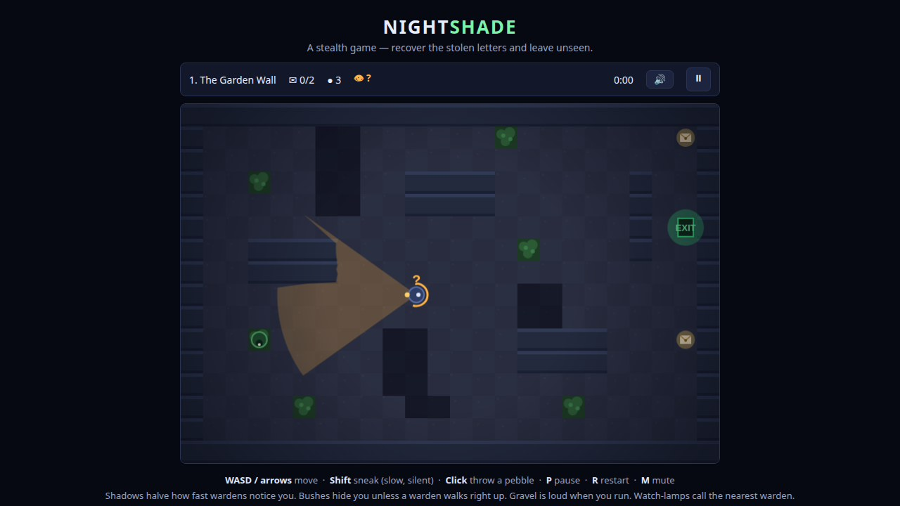

# Nightshade

[](https://make.fun/bounty/best-stealth-game-20261121-1759?ref=vbrytm16)
[](https://make.fun/bounty/best-stealth-game-20261121-1759?ref=vbrytm16)
[](https://make.fun/bounty/best-stealth-game-20261121-1759?ref=vbrytm16)

A top-down stealth game. You are Wren, a night courier: wardens patrol the
estate with lanterns, and their vision cones are the only thing that can
catch you. Stay in shadows and bushes, sneak across gravel, toss pebbles to
lure wardens away, gather every stolen letter, and leave by the green gate
unseen.



- **Five levels:** The Garden Wall, The Courtyard, The Library, The Gallery
  and The Vault — each with its own patrols, cover and letters to recover.
- **Wardens** patrol, pause to look around, grow suspicious before they
  catch you, chase when they are sure, search where they last saw you, and
  come to investigate noises. Their vision cones are cut by every wall.
- **Watch-lamps** sweep a beam back and forth and call the nearest warden
  when the beam finds you.
- **Stealth tools:** shadows halve how fast wardens notice you, bushes hide
  you completely unless a warden walks right up, sneaking is silent, gravel
  is loud under running feet, and pebbles make noise where they land.
- **Three stars per level:** escape, collect every letter, and never be
  suspected. Your progress and best stars are saved in the browser.
- All art is drawn on a canvas in code and all sound is made with Web Audio,
  so there are no image or audio files and no network requests.

## Controls

| Input | Action |
| --- | --- |
| WASD / arrow keys | Move |
| Hold SHIFT | Sneak: slower but silent |
| Mouse + left click | Aim and throw a pebble |
| P / Esc | Pause |
| R | Restart the level |
| M | Mute |

## Run it

No build step. Open `game/index.html` in desktop Chrome, or serve it locally
with Node 22:

```sh
node serve.ts          # http://localhost:8080
```

To take the screenshots again (headless Chrome, real renders of the `?shot=`
scenes listed in `shots.json`):

```sh
node shoot.ts /path/to/chrome
```

To build the bounty dossier:

```sh
mkdir -p out && MAKEFUN_OUTPUT_DIR=out node main.ts
```

---

Made for [make.fun](https://make.fun/?ref=vbrytm16).
